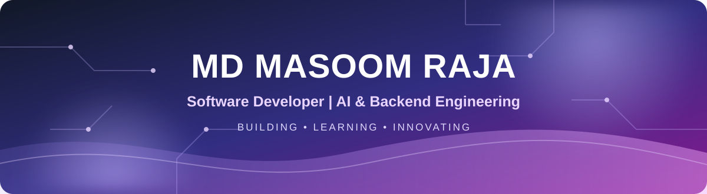

<div align="center">



<br/>

<a href="https://readme-typing-svg.demolab.com">
  
</a>

<br/>

<a href="https://github.com/masoomraja"></a>
<a href="https://github.com/masoomraja?tab=repositories"></a>
<a href="https://github.com/masoomraja?tab=stars"></a>

<br/><br/>


</div>

---

## 👨‍💻 About Me

```java
public class MasoomRaja {

    String role = "Software Developer";
    String focus = "Backend Engineering & AI Applications";

    String[] languages = {
        "Java", "Python", "JavaScript", "SQL"
    };

    String[] interests = {
        "Backend Development",
        "Generative AI",
        "Cloud & DevOps",
        "Building useful products"
    };

    String currentlyBuilding =
        "AI-powered and full-stack projects";
}
```

I'm **MD Masoom Raja**, a developer interested in building practical software, backend systems, and AI-powered applications. I enjoy learning new technologies, experimenting with local AI tools, and turning ideas into useful projects.

- 🔭 Exploring backend engineering and AI-integrated applications
- 🤖 Interested in Generative AI, local LLMs, and intelligent automation
- 🧩 Building projects that combine APIs, databases, and modern interfaces
- 🌱 Always learning, improving, and building through code

---

## ⚡ Tech Stack

### Languages
<p>
  
</p>

### Backend & Frameworks
<p>
  
</p>

### Databases
<p>
  
</p>

### Developer Tools & Platforms
<p>
  
</p>

### GenAI
<p>
  
  
  
</p>

---

## 🔥 Featured Projects

<table>
<tr>
<td width="50%" valign="top">

### 🚀 [NEXOVRA](https://github.com/masoomraja/NEXOVRA)

**AI-Powered Anomaly Detection & Operations Dashboard**

An end-to-end telemetry monitoring and incident alerting platform combining a Java backend, Python ML service, and React dashboard.

**Highlights**
- Isolation Forest anomaly detection
- JWT authentication and role-based access
- Email and Slack alert integrations
- Incident acknowledgement and resolution

**Stack:** Java · Spring Boot · Python · FastAPI · React · Docker

</td>
<td width="50%" valign="top">

### 🎓 [Fee Query AI](https://github.com/masoomraja/fee-query-ai)

**AI School Fee Management Chatbot**

A Spring Boot chatbot that answers student fee, payment, and school data questions using natural language and a local LLM.

**Highlights**
- Natural-language fee queries
- LM Studio local LLM integration
- Dashboard analytics and charts
- Database-backed fallback responses

**Stack:** Java 21 · Spring Boot · LM Studio · Thymeleaf · H2/MySQL

</td>
</tr>
<tr>
<td width="50%" valign="top">

### 🧠 [NEXUS](https://github.com/masoomraja/NEXUS-AI-Powered-Cloud-Incident-Deployment-Intelligence-Platform)

**Cloud Observability & Incident Response**

A cloud operations platform focused on service health, incident response, root-cause analysis, and deployment risk.

**Highlights**
- AI-assisted root-cause analysis
- Deployment risk assessment
- Real-time updates with Socket.IO
- DORA analytics

**Stack:** React · TypeScript · Node.js · Express · PostgreSQL · Docker

</td>
<td width="50%" valign="top">

### 💻 [More Projects](https://github.com/masoomraja?tab=repositories)

Explore my repositories for more experiments, learning projects, and development work.

<a href="https://github.com/masoomraja?tab=repositories">
  
</a>

</td>
</tr>
</table>

---

## 📊 GitHub Analytics

<div align="center">


<br/>


<br/>


</div>

---

## 🤝 Let's Connect

<div align="center">

<a href="https://github.com/masoomraja">
  
</a>
<a href="https://github.com/masoomraja?tab=repositories">
  
</a>

<br/><br/>

**Thanks for stopping by!**

*Keep learning. Keep building. Keep shipping. 🚀*

</div>
